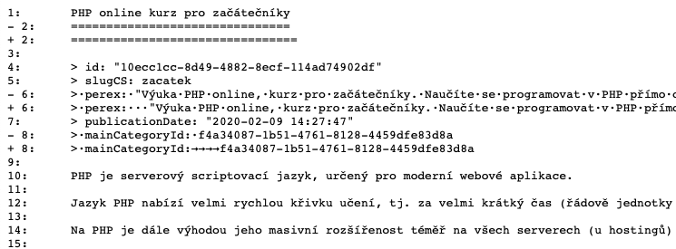
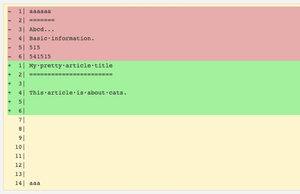

# Simple PHP Diff

A lightweight PHP library for fast text comparison and difference visualization. Find the quick difference between two text files and render the results in plain text or HTML format.

## Key Principles

- **Line-by-line comparison** - Compares texts line by line with numbered output for easy change tracking
- **Immutable result object** - Returns a `Diff` object containing original, target, formatted diff, and changed line numbers
- **Dual output modes** - Plain text diff output and styled HTML rendering with color-coded changes
- **Strict mode support** - Optional strict comparison that preserves different line ending formats
- **Whitespace visualization** - Pretty rendering shows tabs as arrows and spaces as dots for clarity
- **Zero dependencies** - Pure PHP implementation requiring only PHP 8.0+

## Architecture

The library consists of two main components with a clean separation of concerns:

```
┌─────────────────────────────────────────────────────────────┐
│                        SimpleDiff                           │
│  ┌─────────────────────────────────────────────────────┐   │
│  │  compare($left, $right, $strict)                    │   │
│  │  - Normalizes line endings (non-strict mode)        │   │
│  │  - Performs line-by-line comparison                 │   │
│  │  - Tracks changed line numbers                      │   │
│  │  - Formats output with line numbers                 │   │
│  └─────────────────────────────────────────────────────┘   │
│                           │                                 │
│                           ▼                                 │
│  ┌─────────────────────────────────────────────────────┐   │
│  │  renderDiff($diff)                                  │   │
│  │  - Converts diff to styled HTML                     │   │
│  │  - Color-codes additions (green) / removals (red)   │   │
│  └─────────────────────────────────────────────────────┘   │
└─────────────────────────────────────────────────────────────┘
                            │
                            ▼
┌─────────────────────────────────────────────────────────────┐
│                          Diff                               │
│  Immutable Value Object                                     │
│  ┌─────────────────────────────────────────────────────┐   │
│  │  - original: string     (normalized left input)     │   │
│  │  - target: string       (normalized right input)    │   │
│  │  - diff: string         (formatted diff output)     │   │
│  │  - changedLines: int[]  (line numbers that changed) │   │
│  └─────────────────────────────────────────────────────┘   │
└─────────────────────────────────────────────────────────────┘
```

## Components

### SimpleDiff

The main comparison engine that processes two text inputs and generates a diff result.

**Methods:**

| Method | Description |
|--------|-------------|
| `compare(string $left, string $right, bool $strict = false): Diff` | Compares two strings and returns a `Diff` object |
| `renderDiff(Diff\|string $diff): string` | Renders the diff as styled HTML |

**Comparison Process:**

1. **Input normalization** (non-strict mode): Converts all line endings (`\r\n`, `\r`) to `\n` and trims whitespace
2. **Line splitting**: Splits both inputs into arrays by newline character
3. **Line-by-line comparison**: Iterates through lines, comparing original vs target
4. **Output formatting**: Prepends each line with status marker (`+`, `-`, or space) and line number
5. **Change tracking**: Records line numbers where differences occur

### Diff

An immutable value object that encapsulates the comparison result.

**Properties (via getters):**

| Property | Type | Description |
|----------|------|-------------|
| `original` | `string` | The normalized left/original input text |
| `target` | `string` | The normalized right/target input text |
| `diff` | `string` | The formatted diff output with line markers |
| `changedLines` | `int[]` | Array of line numbers (1-indexed) that differ |

**String Conversion:**

The `Diff` object implements `__toString()` which returns the formatted diff string, allowing direct string casting.

## 📦 Installation

It's best to use [Composer](https://getcomposer.org) for installation, and you can also find the package on
[Packagist](https://packagist.org/packages/baraja-core/simple-php-diff) and
[GitHub](https://github.com/baraja-core/simple-php-diff).

To install, simply use the command:

```shell
$ composer require baraja-core/simple-php-diff
```

You can use the package manually by creating an instance of the internal classes, or register a DIC extension to link the services directly to the Nette Framework.

### Requirements

- PHP 8.0 or higher

## Basic Usage

### Simple Text Comparison

```php
use Baraja\DiffGenerator\SimpleDiff;

$left = 'First text';
$right = 'Second text';

$diff = (new SimpleDiff)->compare($left, $right);

// Output the diff as plain text
echo '<code><pre>' . htmlspecialchars((string) $diff) . '</pre></code>';
```

### Get Changed Line Numbers

```php
$diff = (new SimpleDiff)->compare($left, $right);

echo 'Changed lines: ' . implode(', ', $diff->getChangedLines());
```

### Render Diff as HTML

```php
$simpleDiff = new SimpleDiff;
$diff = $simpleDiff->compare($left, $right);

// Returns styled HTML with color-coded changes
echo $simpleDiff->renderDiff($diff);
```

## Output Format

### Plain Text Output

The diff output uses a standardized format:

```
  1| unchanged line
- 2| removed·line·with·visible·spaces
+ 2| added→→→→line·with·visible·tabs
  3| another unchanged line
```

**Format explanation:**

- Lines starting with `  ` (two spaces) are unchanged
- Lines starting with `- ` indicate content from the original (left) text
- Lines starting with `+ ` indicate content from the target (right) text
- Line numbers are right-padded and followed by `| `
- Spaces are rendered as `·` (middle dot)
- Tabs are rendered as `→→→→` (four arrows)

### HTML Output

The `renderDiff()` method generates HTML with inline styles:

```html
<pre class="code">
<div>  1| unchanged line</div>
<div style="background:#e7acac">- 2| removed line</div>
<div style="background:#a2f19c">+ 2| added line</div>
<div>  3| another unchanged line</div>
</pre>
```

**Color coding:**

- **Green background** (`#a2f19c`): Added lines (prefixed with `+`)
- **Red background** (`#e7acac`): Removed lines (prefixed with `-`)
- **No background**: Unchanged lines

## Visual Examples

### Plain Text Diff Output



### HTML Rendered Diff



## Comparison Modes

### Non-Strict Mode (Default)

In non-strict mode (default), the library normalizes line endings before comparison:

- Converts `\r\n` (Windows) to `\n`
- Converts `\r` (old Mac) to `\n`
- Trims leading and trailing whitespace from both inputs

This mode is ideal for comparing content where line ending differences should be ignored.

```php
// Non-strict comparison (default)
$diff = (new SimpleDiff)->compare($left, $right);
$diff = (new SimpleDiff)->compare($left, $right, false);
```

### Strict Mode

Strict mode preserves the original line endings and whitespace, useful when you need to detect differences in line termination characters.

```php
// Strict comparison - preserves line endings
$diff = (new SimpleDiff)->compare($left, $right, true);
```

## Working with the Diff Object

### Accessing Original and Target Text

```php
$diff = (new SimpleDiff)->compare($left, $right);

// Get the normalized original text
$original = $diff->getOriginal();

// Get the normalized target text
$target = $diff->getTarget();
```

### Getting the Raw Diff String

```php
$diff = (new SimpleDiff)->compare($left, $right);

// Using getter method
$diffString = $diff->getDiff();

// Using string casting (equivalent)
$diffString = (string) $diff;
```

### Working with Changed Lines

```php
$diff = (new SimpleDiff)->compare($left, $right);
$changedLines = $diff->getChangedLines();

// Example output: [2, 5, 8] - lines 2, 5, and 8 were modified
foreach ($changedLines as $lineNumber) {
    echo "Line {$lineNumber} was changed\n";
}

// Check if any changes occurred
if (count($changedLines) === 0) {
    echo "No differences found!";
}
```

## Advanced Examples

### Comparing Files

```php
$originalFile = file_get_contents('/path/to/original.txt');
$modifiedFile = file_get_contents('/path/to/modified.txt');

$simpleDiff = new SimpleDiff;
$diff = $simpleDiff->compare($originalFile, $modifiedFile);

// Check if files are identical
if (empty($diff->getChangedLines())) {
    echo "Files are identical.";
} else {
    echo "Files differ on lines: " . implode(', ', $diff->getChangedLines());
    echo "\n\n";
    echo $diff;
}
```

### Custom HTML Rendering

If you need custom styling, you can process the diff string yourself:

```php
$diff = (new SimpleDiff)->compare($left, $right);

$lines = explode("\n", $diff->getDiff());
$html = '<div class="my-diff-container">';

foreach ($lines as $line) {
    $firstChar = $line[0] ?? '';
    $cssClass = match ($firstChar) {
        '+' => 'diff-added',
        '-' => 'diff-removed',
        default => 'diff-unchanged',
    };
    $html .= sprintf('<div class="%s">%s</div>', $cssClass, htmlspecialchars($line));
}

$html .= '</div>';
echo $html;
```

### Integration with Version Control Display

```php
function showCommitDiff(string $oldContent, string $newContent): string
{
    $simpleDiff = new SimpleDiff;
    $diff = $simpleDiff->compare($oldContent, $newContent);

    $changedCount = count($diff->getChangedLines());

    $output = "<h3>Changes: {$changedCount} line(s) modified</h3>";
    $output .= $simpleDiff->renderDiff($diff);

    return $output;
}
```

## Author

**Jan Barášek** - [https://baraja.cz](https://baraja.cz)

## 📄 License

`baraja-core/simple-php-diff` is licensed under the MIT license. See the [LICENSE](https://github.com/baraja-core/simple-php-diff/blob/master/LICENSE) file for more details.
